# Báo cáo nhóm — Day 02 Discovery & Problem Framing

> Bản chung của nhóm, viết trên repo do nhóm trưởng fork. Không copy file này sang repo cá nhân.
> Template chi tiết và prompt mẫu: [docs/01-worksheet.md](../../docs/01-worksheet.md). Bài mẫu: [docs/02-deliverable-example.md](../../docs/02-deliverable-example.md).

## 1. Thông tin nhóm

- Tên nhóm: G4
- Thành viên: Đức, Thanh, Hùng, Duy, Hưng — xem thêm `TEAM.md`
- Candidate problem được chọn (1 câu): Khi nộp hồ sơ thực tập nhiều công ty, sinh viên CNTT/AI muốn đối soát JD với CV nhanh và đủ từ khóa, để giảm thời gian tùy biến hồ sơ và giảm rủi ro bị loại sớm ở vòng lọc
- Quyết định cuối: **Go, phạm vi nhỏ** (dùng tool/checklist có sẵn + HITL; không tự xây scorer)

---

## 2. Hội tụ nhóm (CP3)

### 2.1. Pitch

| # | Người đưa ra | Candidate (Job Story ngắn) | Actor | Bottleneck | Câu hỏi phản biện nhận được (ai hỏi) |
|---:|---|---|---|---|---|
| 1 | Hùng | Khi làm dự án nhóm, tôi muốn theo dõi thay đổi code của các thành viên để tránh xung đột và cập nhật code kịp thời | Thành viên nhóm phát triển phần mềm | Xem và xử lý conflict (~10–20 phút/lần) | Baseline 10–20 phút lấy từ đâu — đã bấm giờ conflict thật trên repo nhóm chưa, hay chỉ ước lượng? (Thanh hỏi) |
| 2 | Hùng | Khi gặp lỗi lập trình, tôi muốn tìm được nguyên nhân và hướng sửa phù hợp để tiếp tục phát triển ứng dụng | Sinh viên IT / lập trình viên | Đọc log, tìm hướng xử lý và thử giải pháp (~15–45 phút/lỗi) | Nếu checklist debug + tài liệu lỗi thường gặp đã giảm được phần lớn thời gian thì vì sao chưa thử Rule trước khi nghĩ tới AI? (Đức hỏi) |
| 3 | Duy | Khi nhận ticket hỗ trợ, tôi muốn phân loại đúng và điều phối đúng bộ phận nhanh, để giảm chuyển sai và khách phải chờ | Nhân viên hỗ trợ / điều phối ticket | Đọc nội dung + quyết định bộ phận nhận; dễ chuyển sai / chuyển tiếp nhiều lần | Đã có tỷ lệ phân loại sai hoặc số lượt chuyển tiếp đo được chưa, hay mới chỉ cảm nhận? Rule theo từ khóa/danh mục đã thử đến đâu? (Hưng hỏi) |
| 4 | Duy | Khi kiểm tra hồ sơ hành chính, tôi muốn phát hiện thông tin thiếu hoặc sai lệch sớm, để không phải trả đi trả lại nhiều vòng | Nhân viên hành chính / tiếp nhận hồ sơ | Đọc và đối chiếu nhiều tài liệu; mất thời gian với khối lượng hồ sơ lớn | Biểu mẫu điện tử + checklist bắt buộc field đã đủ giảm bao nhiêu % hồ sơ lỗi trước khi cần hỗ trợ đọc tài liệu? (Hùng hỏi) |
| 5 | Duy | Khi lên kế hoạch nhập nguyên liệu quán ăn, tôi muốn dự báo nhu cầu sát hơn, để giảm lãng phí và hạn chế hết món | Chủ quán / nhân viên kho–bếp | Ước lượng nhu cầu theo cảm tính hoặc số liệu thô; sai số dẫn đến dư hoặc thiếu | Dữ liệu bán hàng hiện có đủ sạch và đủ dài để đo sai số dự báo chưa? Phương pháp trung bình động/mùa vụ đơn giản đã thử chưa? (Thanh hỏi) |
| 6 | Đức | Khi nộp hồ sơ thực tập 5–8 công ty, tôi muốn đối soát JD với CV nhanh để bổ sung đúng từ khóa và project | Sinh viên năm 3–4 CNTT/AI | So khớp JD–CV + tìm từ khóa thiếu + viết lại (~50–55'/bộ; tổng ~75'/bộ) | Mỗi ATS chấm khác nhau — “match 90% từ khóa” đo theo JD nào? Bảng Excel đối chiếu đã thử bao nhiêu bộ trước khi cần AI? (Duy hỏi) |
| 7 | Đức | Khi sắp nộp bài lab AI, tôi muốn tự check nhanh 11 tiêu chí rubric để không bị trừ điểm hình thức | Sinh viên lớp thực hành AI (~100 người) | Dò từng mục + đếm checklist theo rubric (~18–20'; dễ sót) | Tiêu chí định tính (vd. “độ sâu reflection”) check thế nào? Script regex/checklist đã cover được bao nhiêu % lỗi hình thức? (Hưng hỏi) |
| 8 | Đức | Khi họp kỹ thuật xong, tôi muốn lấy đúng quyết định + action item (ai–việc–deadline) để recap/tạo ticket trong ~15 phút, không nghe lại 60' | Thư ký họp / Tech Lead / PM nhóm kỹ thuật | Nghe lại transcript + lọc quyết định & người nhận task | Transcript tiếng Việt lẫn thuật ngữ code sai nhiều thì sao? Đã thử template recap + ghi note trong họp chưa? (Thanh hỏi) |
| 9 | Hưng | Khi lead mới về từ web/ads/sự kiện, tôi muốn phân loại nhu cầu–ngân sách và giao đúng Sales nhanh, để không bỏ sót hoặc giao sai người | Lead Ops / Sales Admin; Sales Consultant; khách chờ | Bước 3–4 phân loại + routing (~8–15'/lead; median Time-to-Assign ~10') | 10 phút/lead là đo thật hay giả định lab? Form chuẩn + rule CRM đã cover bao nhiêu % trước khi cần LLM/Agent? (Đức hỏi) |
| 10 | Hưng | Khi khách hỏi giá/pháp lý/ưu đãi dự án, tôi muốn tìm đúng thông tin đang hiệu lực nhanh, để tư vấn kịp và không nói sai | Sales Consultant / Sales Advisor BĐS | Bước 2–3 tra cứu PDF/Excel/slide + so sánh (~10–20'/lượt) | “Tài liệu đang hiệu lực” lấy từ nguồn nào? Thư viện 1 nguồn sự thật + version đã thử chưa, hay nhảy thẳng RAG? (Hùng hỏi) |
| 11 | Thanh | Khi cần báo giá căn hộ chuyển nhượng, tôi muốn có mức giá tham chiếu nhanh từ giao dịch–vị trí–diện tích–tình trạng, để tư vấn kịp và giảm thời gian gom thông tin thị trường | Sale BĐS (chuyển nhượng); khách mua/bán | Gom dữ liệu giao dịch + đặc điểm căn rồi ước giá thủ công; dễ lệch nếu data cũ / không phản ánh thực tế căn | MAE/MAPE và “tỷ lệ khách chấp nhận giá” đo trên bộ dữ liệu nào? Đã có bảng so sánh căn tương đương (comps) thủ công chưa, hay nhảy thẳng Agent định giá? (Hưng hỏi) |
| 12 | Thanh | Khi rà soát hợp đồng mua bán, tôi muốn phát hiện sớm điều khoản bất lợi / thiếu sót, để sale và khách biết chỗ cần hỏi lại trước khi ký | Sale BĐS; khách; (hậu kiểm) chuyên viên pháp lý | Đọc hợp đồng dài, đối chiếu checklist điều khoản; dễ bỏ sót hoặc diễn giải sai quy định phức tạp | Checklist theo loại hợp đồng + luật sư/legal review đã cover case nào? AI bỏ sót điều khoản quan trọng thì ai chịu trách nhiệm trước khi ký? (Hùng hỏi) |

### 2.2. Cluster

Nhóm gom **12 candidate** đã pitch (đủ 5 thành viên) theo **cùng một nút thắt nhận thức**, không gom theo ngành hay theo tên giải pháp.

| Cluster | Các candidate | Pattern chung | Nhận định nhanh của nhóm |
|---|---|---|---|
| A — Phân loại & điều phối | #3 Ticket hỗ trợ (Duy), #9 Lead → Sales (Hưng) | Đầu vào đến liên tục → người đọc tay → gán đúng người/bộ phận; sai thì chuyển tiếp / khách chờ | Cùng “routing problem”. Metric đẹp (time-to-assign, % chuyển sai) nhưng **bằng chứng baseline** và quyền tiếp cận vận hành thật còn mỏng |
| B — Đối chiếu tài liệu / checklist | #4 Hồ sơ hành chính (Duy), #6 JD ↔ CV (Đức), #7 Rubric lab (Đức), **#12 Rà soát hợp đồng (Thanh)** | Hai nguồn (chuẩn/checklist vs bản đang đọc) đặt cạnh nhau → dò tay → chỉ ra chỗ thiếu/rủi ro | Pattern rõ. #6/#7 dễ kiểm chứng với SV; **#12** cùng pattern nhưng domain pháp lý + rủi ro bỏ sót điều khoản → feasibility/viability lab thấp hơn |
| C — Tra cứu & chẩn đoán | #1 Git conflict (Hùng), #2 Debug lỗi (Hùng), #10 Tra cứu tài liệu dự án BĐS (Hưng) | Thông tin nằm rải → tìm/đọc/so sánh → mới hành động được | Pain thật nhưng scope dễ phình. #1–#2 đã có Rule/checklist mạnh → AI khó “thắng” No AI |
| D — Tái tạo quyết định sau họp | #8 Action item từ họp (Đức) | Nghe lại / đọc transcript → lọc quyết định + người nhận + deadline | Đầu vào–đầu ra rõ; phụ thuộc chất lượng transcript tiếng Việt + thuật ngữ kỹ thuật |
| E — Dự báo / ước lượng từ dữ liệu | #5 Nguyên liệu quán ăn (Duy), **#11 Định giá căn hộ chuyển nhượng (Thanh)** | Gom tín hiệu dữ liệu → ra một con số định hướng quyết định (nhập hàng / báo giá) | Metric (MAE/MAPE, phút) nghe chặt nhưng **data giao dịch BĐS cập nhật + ground truth** khó có trong lab; dễ trượt sang “xây Agent định giá” |

**Quy tắc gom cluster đã thống nhất:** nếu hai candidate chỉ khác “ngành” nhưng cùng bước nghẽn nhận thức (đọc → phân loại → gán / đối chiếu / ước lượng), thì cùng một cluster. Ngược lại, không nhét Lead Scoring và JD–CV vào một cluster chỉ vì cả hai đều “có AI”. Tên sản phẩm kiểu *ResaleValuer / ContractGuard Agent* bị gạch khỏi tầng opportunity.

### 2.3. Opportunity Solution Tree rút gọn

Sau khi nhìn cluster, nhóm không nhảy thẳng sang tool. Trước hết chọn **1 outcome đo được** đủ rộng để bao các opportunity mạnh nhất, đủ hẹp để lab không vỡ scope.

Luận điểm chọn outcome:

1. Cluster B và một phần A/D đều là *giảm thời gian từ thông tin thô → quyết định hành động đúng*.
2. Outcome phải nói về **kết quả người dùng**, không nói “xây agent / RAG / chatbot”.
3. Các nhánh bên dưới chỉ được là **pain/opportunity**; tên tính năng bị gạch.

```text
OUTCOME: Giảm thời gian từ lúc có tài liệu/đầu vào đến lúc có quyết định hành động đúng
         (sửa hồ sơ / nộp bài / giao việc / gọi khách / báo giá tham chiếu), mà không tăng lỗi sót hoặc giao nhầm

├── Opportunity A: Phải đối chiếu thủ công hai nguồn (chuẩn vs bản làm) → chậm và dễ sót
│     (ứng với cluster B: JD↔CV, rubric lab, hồ sơ hành chính, rà soát hợp đồng)
├── Opportunity B: Phải phân loại và gán đúng người/bộ phận khi đầu vào đến liên tục
│     (ứng với cluster A: ticket, lead→Sales)
├── Opportunity C: Phải tìm lại thông tin đang hiệu lực hoặc nguyên nhân lỗi trong đống tài liệu/log
│     (ứng với cluster C: debug, tra cứu dự án, git conflict)
├── Opportunity D: Sau họp, quyết định và việc giao bị phân mảnh → phải nghe lại mới tái tạo được
│     (ứng với cluster D: action item)
└── Opportunity E: Phải ước lượng từ nhiều tín hiệu dữ liệu (nhu cầu / giá thị trường) khi thiếu comps cập nhật
      (ứng với cluster E: dự báo nguyên liệu, định giá căn chuyển nhượng)

     ✗ "LeadScorer Agent / multi-agent enrich-score-route"   ← SOLUTION
     ✗ "Chatbot đối soát CV" / "ATS optimizer"               ← SOLUTION
     ✗ "RAG trên knowledge base dự án"                       ← SOLUTION
     ✗ "Script tự chấm rubric"                               ← SOLUTION (cũng là cách làm, không phải pain)
     ✗ "Dự báo tồn kho bằng model ML"                        ← SOLUTION + lệch outcome chính
     ✗ "ResaleValuer AI Agent"                               ← SOLUTION
     ✗ "ContractGuard AI Agent"                              ← SOLUTION
```

**Kết luận trung gian (trước khi chấm điểm):**  
Opportunity A và B “sạch” nhất để shortlist vì: actor chỉ ra được, quy trình 5–7 bước vẽ được, metric phút/% lỗi thiết kế được. Opportunity C dễ thành dự án tìm kiếm mở. Opportunity D phụ thuộc transcript. Cluster E (quán ăn + định giá BĐS) tạm gác vì data/ground truth khó có trong lab; #12 cùng opportunity A nhưng rủi ro pháp lý khiến lab ưu tiên #6.

### 2.4. Chấm điểm shortlist (1–5)

**Cách shortlist (không bỏ phiếu cảm tính):** từ mỗi cluster “sạch”, lấy **1 đại diện mạnh nhất** theo tiêu chí lab :

| Cluster nguồn | Đại diện đưa vào shortlist | Vì sao là đại diện |
|---|---|---|
| B — Đối chiếu | **#6 JD ↔ CV thực tập (Đức)** | Có baseline 75'/bộ, có tín hiệu ATS, actor = đúng đối tượng nhóm |
| B — Đối chiếu (đối trọng trong lớp) | **#7 Self-check rubric lab (Đức)** | Actor ~100 SV, lặp mỗi lab, metric điểm hình thức; nhưng Rule/script có thể đã đủ |
| A — Phân loại & điều phối | **#9 Lead → giao Sales (Hưng)** | Quy trình + HITL + 4 mức can thiệp rất rõ; impact gần doanh thu; baseline còn là giả định lab |


**Thang điểm:** 1 = yếu / thiếu bằng chứng; 5 = rõ, đo được, nhóm làm được trong lab. Điểm là kết quả thảo luận từng tiêu chí (không lấy trung bình cảm tính một phát).

| Candidate | Actor rõ | Quy trình rõ | Pain có bằng chứng | Impact đo được | Vừa sức lab | So sánh được No AI/Rule/Workflow/Agent | Nhóm hiểu domain | Tổng |
|---|---:|---:|---:|---:|---:|---:|---:|---:|
| #6 Đối soát JD ↔ CV | 5 | 5 | 4 | 5 | 5 | 5 | 5 | **34** |
| #7 Self-check rubric lab | 5 | 5 | 4 | 4 | 5 | 3 | 5 | **31** |
| #9 Lead phân loại & giao Sales | 5 | 5 | 3 | 5 | 3 | 5 | 3 | **29** |

**Ghi chú chấm (tóm tắt tranh luận tiêu chí):**

- **Pain có bằng chứng:** #6 có câu chuyện bị loại ATS + phút/bộ hồ sơ; #7 có ước lượng ~25/100 SV bị trừ hình thức; #9 tự nhận median 10' là *giả định lab* → trừ điểm bằng chứng.
- **Vừa sức lab:** #6/#7 tự làm trên JD/CV và file lab của chính nhóm; #9 cần giả lập CRM/lead ops hoặc phỏng vấn người ngoài → feasibility thấp hơn trong 1 buổi.
- **So sánh 4 mức:** #9 rất mạnh (Rule routing vs Workflow hỗ trợ chấm điểm vs Agent tự gán + HITL). #7 yếu hơn vì checklist/script (Rule) có thể giải phần lớn → khó biện minh nhảy Workflow/Agent.
- **Nhóm hiểu domain:** sinh viên hiểu JD/CV và rubric lab hơn vận hành Lead Ops BĐS.

**Candidate được chọn:** `#6 — Đối soát yêu cầu tuyển dụng (JD) với CV xin thực tập` (Đức)

**Vì sao chọn:**

1. **Khớp outcome** đã chốt: giảm thời gian từ tài liệu đầu vào → quyết định sửa/nộp đúng, giảm lỗi sót (từ khóa thiếu / hồ sơ lệch JD).
2. **Điểm tổng cao nhất (34/35)** với ưu thế ở bằng chứng, vừa sức lab, và domain nhóm nắm được — đúng tinh thần lab: ưu tiên bài kiểm chứng được, không ưu tiên bài “nghe lớn” nhất.
3. Bottleneck chỉ rõ 3 bước (so khớp / liệt kê từ khóa thiếu / viết lại) kèm phút; No AI đã có (Excel 2 cột + checklist) để so thật với Workflow hỗ trợ đối chiếu.
4. Phản biện về “mỗi ATS khác nhau” **không giết bài**: nhóm thu hẹp success metric về *thời gian hoàn thiện bộ hồ sơ* + *độ phủ từ khóa so với JD đang nộp*, không claim “đỗ mọi ATS”.

**Vì sao loại các candidate còn lại (shortlist + ngoài shortlist):**

| Candidate | Lý do loại / xếp sau |
|---|---|
| #7 Rubric lab | Gần điểm nhưng tiêu chí định tính khó eval; Rule/script có thể đủ → bài dễ kết luận No AI sớm, ít học được so sánh 4 mức |
| #9 Lead → Sales | Pattern và kiến trúc can thiệp đẹp, nhưng baseline giả định + domain Lead Ops/BĐS nhóm chưa tiếp cận trực tiếp; đưa vào **hướng tiếp theo / giả định CP4** nếu sau này mở rộng |
| #3 Ticket routing | Cùng cluster A với #9; yếu hơn #9 về narrative HITL/metric đã viết sẵn; không shortlist trùng pattern |
| #4 Hồ sơ hành chính | Cùng cluster B nhưng quyền với dữ liệu hồ sơ thật kém hơn JD/CV cá nhân |
| #8 Action item họp | Opportunity D hợp lệ; phụ thuộc transcript tiếng Việt; để hướng tiếp theo |
| #1 Git conflict, #2 Debug | Cluster C; workaround Rule/checklist mạnh; impact cá nhân nhưng khó chứng minh AI cần thiết hơn tài liệu |
| #10 Tra cứu tài liệu dự án BĐS | Cùng cluster C; cần kho tài liệu “nguồn sự thật” — feasibility thấp trong lab |
| #5 Nguyên liệu quán | Lệch outcome và domain; không shortlist |
| #11 Định giá căn chuyển nhượng (Thanh) | Cluster E; metric MAE/MAPE hấp dẫn nhưng thiếu data giao dịch cập nhật + ground truth trong lab; dễ solution-first (ResaleValuer Agent) |
| #12 Rà soát hợp đồng (Thanh) | Cùng cluster B với #6 nhưng rủi ro pháp lý / bỏ sót điều khoản cao; bắt buộc legal HITL → vừa sức lab kém hơn JD↔CV |

**Xử lý bất đồng:**

- **Hưng** nghiêng về #9 vì gần bài toán doanh nghiệp và minh họa đủ Rule / Workflow / Agent / HITL.
- **Thanh** nghiêng về bài BĐS (#11/#12) vì gần vận hành sale thực tế; nhóm ghi nhận nhưng xếp sau vì data/pháp lý khó kiểm chứng trong buổi lab.
- **Đức** và phần lớn nhóm giữ #6 vì lab chấm *chất lượng lập luận + kiểm chứng*, không chấm độ “enterprise”.
- Thỏa thuận: **chốt #6 làm candidate chính**. #9, #7, #11, #12 ghi vào “hướng tiếp theo”. Ở CP4, nếu kiểm chứng JD–CV cho thấy pain yếu (ví dụ Excel đã đủ dưới 20'), nhóm **được phép quay lại xét #9** — đây là ngưỡng đổi hướng có điều kiện, không phải bỏ phiếu lại cảm tính.

---

## 3. Kiểm chứng + research giải pháp đã có (CP4)

Candidate đang kiểm chứng: **#6 Đối soát JD ↔ CV xin thực tập**.

### 3.1. Assumption Map

| # | Giả định | Loại (Value / Usability / Feasibility / Viability) | Quan trọng (1–5) | Đã có bằng chứng (1–5) | Kiểm chứng trước? |
|---:|---|---|---:|---:|---|
| 1 | Sinh viên CNTT/AI năm 3–4 thường tùy biến CV theo từng JD và mất nhiều thời gian ở bước so khớp / liệt kê từ khóa thiếu | Value | 5 | 2 | ✅ (desk research + cần phỏng vấn SV ngoài nhóm) |
| 2 | Bottleneck chính là đối chiếu thủ công JD–CV (bước 3–5), không phải format/xuất PDF | Value | 5 | 2 | ✅ |
| 3 | “Match rate / độ phủ từ khóa” đo được theo từng JD cụ thể và hữu ích hơn là claim “đỗ mọi ATS” | Usability | 5 | 3 | ✅ (tài liệu sản phẩm Jobscan / Resume Worded) |
| 4 | Phương án No AI (Excel 2 cột + checklist) hoặc tool có sẵn đã đủ với một phần người dùng | Feasibility | 4 | 4 | ✅ (research tool) |
| 5 | Người dùng chấp nhận dùng tool đối chiếu nếu vẫn tự quyết định câu chữ trên CV (không để máy bịa kinh nghiệm) | Viability | 5 | 3 | ✅ |
| 6 | Nhóm tự xây scorer/ATS riêng mang lại giá trị hơn tool thị trường | Feasibility | 4 | 1 | ✅ (research cho thấy thị trường đã dày) |

Giả định nhóm kiểm chứng trong buổi này: **#1, #2, #3, #4, #6** (ô quan trọng cao / bằng chứng thấp hoặc quyết định hướng giải pháp).

### 3.2. Kiểm chứng

Cách đã dùng trong lab này: **Desk research có nguồn mở được + đối chiếu tài liệu sản phẩm thật** .  
**Phỏng vấn Mom Test với SV ngoài nhóm:** khung đã soạn; snapshot bên dưới để trống nội dung hành vi — **không bịa lời nói**. Mỗi thành viên cần hoàn tất ≥1 buổi trước khi khóa CP4 (ghi vào `report/assets/cp4-interview-snapshot-N.md`).

#### Bằng chứng desk research (đã kiểm)

| Nguồn                                                                                                                                           | Phát hiện liên quan giả định                                                                                                                                                                          | Hệ quả                                                                                                                                                                     |
| ----------------------------------------------------------------------------------------------------------------------------------------------- | ----------------------------------------------------------------------------------------------------------------------------------------------------------------------------------------------------- | -------------------------------------------------------------------------------------------------------------------------------------------------------------------------- |
| [University of Maryland Career Center — Resume How-To](https://careers.umd.edu/find-jobs-internships/resumes-cover-letters/resume-how-to-guide) | ATS/AI được dùng trong tuyển dụng; hướng dẫn **đọc JD, bôi từ khóa, đưa ngôn ngữ JD vào CV**; dùng cả dạng đầy đủ lẫn viết tắt                                                                        | Xác nhận pain “đối chiếu JD–CV / từ khóa” là thực hành chuẩn khi xin việc–thực tập, không phải bịa                                                                         |
| [Jobscan](https://www.jobscan.co/)                                                                                                              | Upload CV + dán JD → match rate theo hard/soft skills, job title, keywords; gợi ý match ~65–75%; **cảnh báo over-optimized resume**                                                                   | Xác nhận metric “độ phủ từ khóa theo JD” dùng được; **phản bác** claim tối ưu điểm càng cao càng tốt / “đỗ mọi ATS”                                                        |
| [Resume Worded — Resume Tailor](https://resumeworded.com/resume-tailor)                                                                         | Làm tay đầy đủ ~**20–30 phút/application**; bước so khớp là chậm nhất; tool rút so khớp còn ~30 giây; base CV tốt thì tailor còn ~10–15 phút. Tool **cố ý không inject** từ khóa giúp bạn — vì dễ bịa | **Tín hiệu phản bác quan trọng:** baseline 75'/bộ trên card có thể cao hơn ước lượng vendor; cần bấm giờ thật. Cũng xác nhận boundary HITL: người phải giữ tính trung thực |
| [Teal — Resume Job Description Match](https://www.tealhq.com/tool/resume-job-description-match)                                                 | Match score 0–100, list missing keywords, gợi ý chỉnh theo JD                                                                                                                                         | Pattern Workflow đã commodity: đối chiếu → khoảng trống → người sửa                                                                                                        |
| [SkillSyncer](https://skillsyncer.com/)                                                                                                         | Free: 2 job match scans/tuần; score /100; student .edu có ưu đãi theo about page                                                                                                                      | Có free tier cho SV; **không có lý do tự xây scorer từ đầu** chỉ để có điểm match                                                                                          |

#### Khung phỏng vấn Mom Test (bắt buộc làm — không hỏi “bạn có muốn AI không?”)

1. Lần gần nhất bạn nộp thực tập/việc, bạn chỉnh CV theo JD thế nào? Kể từng bước.
2. Bước nào lâu nhất? Khoảng bao nhiêu phút? Có bấm giờ không?
3. Đã bị loại sớm / không được phản hồi trong trường hợp nghi do thiếu từ khóa chưa? Chuyện gì xảy ra?
4. Bạn đã dùng Excel, checklist, Jobscan, Teal, ChatGPT… chưa? Giữ / bỏ vì sao?
5. Bạn có chấp nhận tool chỉ **chỉ ra chỗ thiếu**, còn câu chữ do bạn viết không?

Interview snapshot — slot 1:

| Trường | Nội dung |
|---|---|
| Người được hỏi (vai trò, không ghi tên thật) | SV năm 4 CNTT, đang ứng tuyển Data Engineer Intern (ngoài nhóm) |
| Câu nói đáng nhớ nhất (nguyên văn) | "Mình đã dùng Airflow trong project nhưng CV lại không ghi đúng tên công nghệ đó." |
| Lần gần nhất gặp vấn đề này: chuyện gì đã xảy ra? | Ứng tuyển 8 vị trí trong một đợt, chỉ nhận được 2 phản hồi; tự rà lại thì thấy một số kỹ năng đã có trong project nhưng chưa được thể hiện rõ / đúng tên trên CV so với JD |
| Hiện đang xử lý bằng cách nào (workaround)? | Đọc JD thủ công → dùng ChatGPT để đối chiếu → tự sửa CV → theo dõi đơn ứng tuyển bằng Google Sheets |
| Mất bao lâu, bao lần? | Khoảng 20–30 phút/vị trí; có lần gần 45 phút; khoảng 8 lần ứng tuyển trong một đợt |
| Insight / opportunity rút ra | Pain không chỉ là “thiếu skill”, mà còn là **skill đã có bằng chứng nhưng chưa map đúng wording JD**. Cần đối chiếu JD–CV để bề mặt những gì đã làm thật; đồng thời **không** tự thêm kinh nghiệm không có |

Interview snapshot — slot 2:

| Trường | Nội dung |
|---|---|
| Người được hỏi (vai trò, không ghi tên thật) | SV năm 3 ngành AI, mới ứng tuyển AI/ML Intern (ngoài nhóm) |
| Câu nói đáng nhớ nhất (nguyên văn) | "Mình không biết kỹ năng nào trong JD thực sự quan trọng, nên thường dùng một CV để nộp nhiều nơi." |
| Lần gần nhất gặp vấn đề này: chuyện gì đã xảy ra? | Nộp 6 công ty, nhận 1 phản hồi; CV chưa thể hiện rõ các kỹ năng NLP và PyTorch đã từng học so với yêu cầu JD |
| Hiện đang xử lý bằng cách nào (workaround)? | Dùng CV chung cho nhiều nơi; hỏi ChatGPT; tự bổ sung mục Skills và sửa phần giới thiệu |
| Mất bao lâu, bao lần? | Khoảng 40–60 phút khi chịu chỉnh CV theo JD; khoảng 5 phút nếu nộp CV chung; đã nộp 6 vị trí trong đợt gần nhất |
| Insight / opportunity rút ra | Người dùng cần **phân loại mức độ quan trọng của yêu cầu JD** (required vs nice-to-have) và chỉ rõ chỗ CV còn mơ hồ — hơn là một “điểm phù hợp” không giải thích được. CV chung = workaround tiết kiệm thời gian nhưng đánh đổi độ khớp |

Tổng hợp:

| Nguồn | Số người / số mẫu | Tín hiệu xác nhận | Tín hiệu phản bác |
|---|---:|---|---|
| Desk research career center + docs sản phẩm | 5 nguồn đã mở link | Pain tùy biến CV theo JD / từ khóa là thực hành được khuyến nghị; bước so khớp là nút thắt; tool Workflow đã có | Baseline 75' có thể cao hơn ước lượng 20–30' (Resume Worded); match score ≠ ATS công ty; over-optimize có hại (Jobscan); thị trường đã có Jobscan/Teal/RW/SkillSyncer → tự xây scorer yếu |
| Phỏng vấn SV ngoài nhóm | **2 / 2** | Cả hai đều tùy biến/ứng tuyển nhiều vị trí; có kỹ năng đã học/làm nhưng CV chưa mirror JD (Airflow; NLP/PyTorch); dùng ChatGPT; đau ở so khớp & ưu tiên yêu cầu | Thời gian thực tế ~20–60' khi chỉnh, hoặc ~5' nếu nộp CV chung — **không ổn định ở 75'**. Điểm số “match” không giải thích được sẽ ít được tin (slot 2). Workaround CV chung phản bác giả định “mọi SV đều tailor kỹ từng JD” |
| Tự bấm giờ 1–2 bộ JD–CV thật (log cá nhân, không thay phỏng vấn) | *khuyến nghị mỗi người ≥1 lần* | *điền phút thật vào đây* | Nếu Excel/tool free đã <20' → kích hoạt ngưỡng đổi hướng xét lại #9 (đã ghi ở CP3) |

**Nhóm đã sửa problem thế nào sau kiểm chứng:**

1. **Thu hẹp claim:** không còn “tăng độ phủ để đỗ mọi ATS” hay “điểm phù hợp” đơn độc. Success metric = **thời gian hoàn thiện 1 bộ theo 1 JD** + **danh sách required/preferred còn thiếu hoặc chưa được thể hiện**, kèm giải thích ngắn.
2. **Bổ sung opportunity từ 2 phỏng vấn:** (a) surface skill **đã có bằng chứng** nhưng chưa khớp wording JD; (b) **tách required vs nice-to-have** để người biết chỉnh phần nào trước — tránh điểm số hộp đen.
3. **Đổi giả thuyết giải pháp:** không tự xây scorer. Hướng = Rule/checklist hoặc Workflow dùng tool có sẵn → người viết lại bullet trung thực → xuất CV.
4. **Siết boundary:** cấm gợi ý thêm kỹ năng/project chưa làm; mọi dòng do người duyệt.
5. **Re-baseline thời gian:** quan sát phỏng vấn = ~20–30' (slot 1), ~40–60' khi chỉnh / ~5' nếu CV chung (slot 2). Card ban đầu 75' **hạ xuống khoảng 30–45' (median khi có tailor)**; target vẫn hướng dưới ~15–20' với checklist/tool, không claim từ 75'.

### 3.3. Research giải pháp đã có

| Công cụ / case / pattern | Link | Giải bước nào trong quy trình? | Điểm mạnh | Khoảng trống / rủi ro | Bài học cho nhóm |
|---|---|---|---|---|---|
| **Jobscan** — ATS resume checker / match rate | https://www.jobscan.co/ | Bước 3–4: so khớp CV với JD, chỉ missing hard/soft skills & keywords; hỗ trợ nhận diện format ATS | Đúng bài “đối chiếu theo từng posting”; có ngưỡng match gợi ý (~65–75%); FAQ thừa nhận ATS khác nhau | Paywall/giới hạn free; match rate **không phải** điểm ATS của employer; dễ over-optimize | Dùng được cho bước so khớp; **không** biến match rate thành KPI “đỗ tuyển”; người vẫn phải sửa CV |
| **Teal — Resume Job Description Match** | https://www.tealhq.com/tool/resume-job-description-match | Bước 3–5: match score, missing keywords, gợi ý chỉnh nội dung theo JD | UX rõ (import CV → dán JD → xem gap); phù hợp Workflow | Free tier giới hạn keyword/AI; gợi ý viết vẫn cần người kiểm tính trung thực | Kiến trúc đúng: AI/tool chỉ **chỉ ra gap + gợi ý**, người quyết định giữ gì |
| **Resume Worded — Resume Tailor / Targeted Resume** | https://resumeworded.com/resume-tailor | Bước 2–4: tách required vs preferred; Relevancy Score; list missing; **không** tự nhét keyword | Minh bạch weighting required > preferred; nêu thời gian làm tay 20–30'; so khớp ~30 giây bằng tool; chống bịa kinh nghiệm | Một phần feedback sâu có thể cần Pro; Relevancy Score cũng là proxy | **Boundary vàng cho lab:** phân tích giúp, viết/chốt là người. Đồng thời ép nhóm đo lại baseline phút |
| **SkillSyncer** — job match scanner | https://skillsyncer.com/ | Bước 3–4 (+ gợi ý bullet có kiểm soát) | Free 2 scans/tuần; score/100; student/edu có ưu đãi theo about page | Free hạn chế; AI rewrite vẫn rủi ro nếu user accept mù | Đủ để SV thử ngay không cần tự code scorer |
| **Pattern No AI (career center)** | https://careers.umd.edu/find-jobs-internships/resumes-cover-letters/resume-how-to-guide | Bước 2–5: highlight JD → đưa ngôn ngữ thật vào CV; format ATS-friendly | Không phụ thuộc vendor; dạy đúng thói quen | Không tự động hóa; vẫn tốn thời gian so khớp | Là **baseline No AI/Rule** để so với Workflow dùng tool |

**Kết luận research:**

```text
Thị trường đã có đủ công cụ làm bước so khớp JD↔CV (Jobscan, Teal, Resume Worded, SkillSyncer).
Không có lý do tự xây ATS/LeadScorer-style engine chỉ để ra match score.

Hướng hợp lý sau CP4:
  No AI/Rule: checklist + bảng Excel đối chiếu required skills
  → hoặc Workflow: dùng tool có sẵn để liệt kê gap trong ~vài phút
  → Người viết lại bullet trung thực → xuất CV
  → HITL: không accept gợi ý kỹ năng chưa làm

Metric lab nên đo: phút/bộ hồ sơ + % required skills của JD đã được cover trung thực
(không đo "điểm ATS giả lập" như sự thật tuyển dụng).
```

---

## 4. Quy trình trước/sau (CP5)

### 4.1. Quy trình hiện tại

Sơ đồ (ASCII, Mermaid hoặc link ảnh trong `report/assets/`):

```text
HIỆN TẠI — ~6 bước, median ~30–45 phút/bộ khi có tailor
(phỏng vấn: ~20–30' hoặc ~40–60' khi chỉnh; ~5' nếu nộp CV chung)

[1 Mở song song CV & JD: ~3']
→ [2 Đọc / bôi yêu cầu trong JD: ~8–12']
→ [3 So khớp từng dòng JD với CV: ~10–20'] ← BOTTLENECK 1
→ [4 Liệt kê từ khóa / skill còn thiếu hoặc chưa thể hiện: ~5–10'] ← BOTTLENECK 2
→ [5 Viết lại bullet / Skills / intro: ~8–15'] ← BOTTLENECK 3
→ [6 Format, xuất PDF, nộp & theo dõi: ~5']
```

| Bước | Actor | Input | Output | Thời gian / tần suất | Ghi chú |
|---:|---|---|---|---|---|
| 1 | Ứng viên SV | File CV + link/PDF JD | Hai nguồn mở song song | ~3' / mỗi vị trí nộp | Thường 5–8 vị trí/đợt |
| 2 | Ứng viên | JD 10–15 gạch đầu dòng | Danh sách yêu cầu đã highlight | ~8–12' | Dễ không tách required vs preferred (slot 2) |
| 3 | Ứng viên | JD đã highlight + CV | Cảm nhận “khớp / thiếu” từng dòng | ~10–20' | Bottleneck: dò tay, dễ sót tech đã làm (slot 1: Airflow) |
| 4 | Ứng viên | Kết quả so khớp | List từ khóa/skill cần bổ sung trên CV | ~5–10' | Đôi khi nhờ ChatGPT đối chiếu chung chung |
| 5 | Ứng viên | List thiếu + kinh nghiệm thật | CV đã chỉnh wording | ~8–15' (hoặc bỏ qua nếu dùng CV chung ~5' cả quy trình) | Rủi ro: bịa skill hoặc bỏ sót skill đã có |
| 6 | Ứng viên | CV đã sửa | PDF nộp + sheet theo dõi | ~5' | |

**Bottleneck chính:** Bước **3–5** — so khớp thủ công, liệt kê gap, viết lại. Đây là chỗ vừa tốn phút vừa dễ **bỏ sót skill đã có** hoặc **không biết ưu tiên yêu cầu nào**.

### 4.2. Quy trình tương lai

Ghi rõ bước nào **Rule**, bước nào **AI**, bước nào **con người**, **boundary** ở đâu, **phương án quay về** khi AI sai.

Sơ đồ Mermaid (tương đương `cp5-workflow-future`; viết thẳng trong báo cáo để GitHub render):

```mermaid
flowchart TD
    S(["BẮT ĐẦU<br/>Chọn 1 vị trí thực tập và JD tương ứng"])
    A["1. ỨNG VIÊN · 1 phút<br/>Tải CV hiện có + JD"]
    B["2. AI / WORKFLOW · 1 phút<br/>Trích xuất yêu cầu REQUIRED / PREFERRED"]
    C["3. AI / WORKFLOW · 2 phút<br/>Đối chiếu JD ↔ CV theo từng yêu cầu<br/>COVER có bằng chứng / GAP / CHƯA RÕ"]
    D["4. ỨNG VIÊN · 4 phút · HITL<br/>Xác minh từng gap và bằng chứng trên CV/project<br/>Không biến skill thiếu thật thành skill đã có"]
    Q{"Mọi gap đã được<br/>xác minh/phân loại?"}
    E["5. AI / WORKFLOW · 2 phút<br/>Gợi ý chỉnh câu chữ theo kinh nghiệm có thật<br/>Chỉ đề xuất, không tự thêm thành tích"]
    F["6. ỨNG VIÊN · 6 phút · HITL<br/>Chỉnh CV, duyệt từng đề xuất<br/>Giữ nguyên tính chính xác"]
    G["7. TOOL + ỨNG VIÊN · 2 phút<br/>Checklist REQUIRED / PREFERRED<br/>Kiểm tra định dạng, xuất PDF"]
    R{"Người dùng xác nhận<br/>CV chính xác và đủ để nộp?"}
    Z(["HOÀN THÀNH 1 CV TAILOR THEO JD<br/>Mục tiêu ≤ 18 phút; ngưỡng thành công < 20 phút"])
    N["RANH GIỚI: Không bịa kinh nghiệm · Không tự nộp CV<br/>Không cam kết vượt ATS · Con người duyệt bản cuối"]

    S --> A --> B --> C --> D --> Q
    Q -->|Có| E --> F --> G --> R
    Q -->|Chưa| D
    R -->|Cần sửa| F
    R -->|Đạt| Z
    Z -.-> N

    classDef start fill:#0f766e,color:#ffffff,stroke:#115e59,stroke-width:2px
    classDef human fill:#ecfdf5,color:#064e3b,stroke:#059669,stroke-width:2px
    classDef ai fill:#eff6ff,color:#1e40af,stroke:#2563eb,stroke-width:2px
    classDef decision fill:#fffbeb,color:#92400e,stroke:#d97706,stroke-width:2px
    classDef guard fill:#fff1f2,color:#9f1239,stroke:#e11d48,stroke-width:1px
    class S,Z start
    class A,D,F human
    class B,C,E,G ai
    class Q,R decision
    class N guard
```



**BOUNDARY:**
- Không tự thêm kỹ năng/project chưa làm.
- Không biến match score thành “đỗ ATS”.
- Không tự nộp hồ sơ.
- Gợi ý câu chữ chỉ dựa trên nội dung CV/project người dùng xác nhận.

**PHƯƠNG ÁN QUAY VỀ:**
- Tool/AI sai hoặc paywall → quay về Excel 2 cột (JD requirement | dòng CV) + checklist required/preferred.
- Gap list không tin được → làm lại bước 2–3 bằng tay theo career-center pattern.

### 4.3. Before / after

| Chỉ số | Trước | Sau (kỳ vọng) | Ghi chú |
|---|---:|---:|---|
| Số bước | 6 | 6 | Không cắt bước kiểm soát; rút thời gian ở so khớp |
| Tổng thời gian | ~30–45' median khi tailor (quan sát PV); card cũ 75' đã hạ | **dưới 20'**/bộ khi tailor | Đo bằng tự bấm giờ ≥8 bộ trong 2 tuần pilot |
| Số bước thủ công | 6/6 | 4/6 nặng người (duyệt gap, viết, nộp); 2 bước Rule/AI hỗ trợ | HITL giữ ở duyệt gap + viết |
| Bottleneck chính | So khớp + liệt kê gap + viết lại | Duyệt gap + viết trung thực | Bottleneck còn lại là điểm kiểm soát chất lượng |
| Rủi ro mới phát sinh | — | AI/tool gợi ý skill ảo; tin match score quá mức; over-optimize | Xử lý bằng boundary + eval + ngưỡng dừng |

---

## 5. Problem Statement v0 (CP5)

| Trường | Nội dung |
|---|---|
| **Actor** | Sinh viên năm 3–4 CNTT/AI đang nộp thực tập nhiều công ty (5–8 vị trí/đợt) |
| **Quy trình** | Mở CV & JD → đọc/bôi yêu cầu → so khớp tay từng dòng → liệt kê từ khóa/skill thiếu hoặc chưa thể hiện → viết lại CV → xuất & nộp |
| **Bottleneck** | So khớp thủ công + liệt kê gap + viết lại (bước 3–5), khoảng 20–40 phút trong tổng ~30–45 phút/bộ khi có tailor |
| **Impact** | Tốn nhiều giờ mỗi đợt tuyển; dễ nộp CV chung (ít tailor) hoặc bỏ sót tech đã làm; tỷ lệ phản hồi thấp trong các case đã kể (vd. 2/8, 1/6) |
| **Success Metric** (baseline → target, cách đo) | Thời gian tailor 1 bộ: baseline **~30–45 phút** (từ phỏng vấn, thay cho 75' ước lượng ban đầu) → target **dưới 20 phút**; đo bằng tự bấm giờ theo từng JD. Kèm: trước khi nộp, có checklist required skills của JD đã được đánh dấu cover/không cover |
| **Boundary** (AI không được làm gì; khi nào cần con người kiểm tra — HITL) | AI/tool không tự thêm kinh nghiệm chưa có, không tự nộp, không cam kết “đỗ ATS”. Người duyệt mọi gap và mọi câu chữ trước khi xuất CV |

Phản biện nhận được (từ AI hoặc nhóm khác) và nhóm có đồng ý không:

- **Metric chỉ đo tốc độ → CV nhanh nhưng kém/trung thực giả?** Đồng ý. Bổ sung ở v1: tỷ lệ gap “có bằng chứng trên CV/project” được người xác nhận; cấm đếm skill mới bịa là thành công.
- **Baseline 30–45' mới từ 2 phỏng vấn, mẫu nhỏ?** Đồng ý một phần. Pilot bắt buộc tự bấm giờ; nếu median thực <20' với Excel thuần thì quay về No AI/Rule.
- **Đã có ChatGPT/Jobscan — còn bài toán không?** Đồng ý cần thu hẹp: bài không phải “có chatbot”, mà là **Workflow cố định** (required/preferred + gap có bằng chứng + HITL) để hơn chat ad-hoc và hơn CV chung.

---

## 6. Mức can thiệp AI (CP6)

### 6.1. Ma trận độ mơ hồ × độ phức tạp

Bài của nhóm nằm ở ô: **độ mơ hồ trung bình × độ phức tạp thấp–trung bình**.

Vì sao:

- **Mơ hồ TB:** mỗi JD khác nhau; “required vs preferred” đôi khi viết mập mờ; cách viết bullet có nhiều biến thể đúng.
- **Phức tạp thấp–TB:** chuỗi bước cố định (đọc JD → đối chiếu → sửa → nộp), ít rẽ nhánh; không cần AI tự quyết định nộp đâu / viết gì tiếp theo.
- → Phù hợp **Workflow** (bước định sẵn, AI/tool chỉ làm một đoạn phân tích), không cần Agent.

### 6.2. So sánh 4 mức

| Mức | Phương án cho bài của nhóm | Đủ khi nào | Rủi ro | Chọn? |
|---|---|---|---|---|
| **No AI** (sửa quy trình) | Excel 2 cột + checklist required/preferred + không nộp CV chung cho vị trí “muốn đậu” | Người đã kỷ luật tailor và chấp nhận ~20–30' | Nhiều SV (slot 2) bỏ tailor vì không biết ưu tiên yêu cầu nào | Phương án quay về / nhóm chỉ cần kỷ luật |
| **Rule** | Rubric highlight: must-have / nice-to-have; bảng tick cover; cấm thêm skill không có trong project list tự khai | JD chuẩn, ít jargon; ứng viên tự tách required tốt | Vẫn chậm ở so khớp dài; khó bắt “đã làm nhưng wording khác” (Airflow) | **Dùng kèm** bước 2 |
| **Workflow** | Rule tách required → tool/AI sinh bảng gap (đã có / thiếu / có bằng chứng chưa hiện) → người duyệt & tự viết → nộp | Cần giảm phút so khớp + giải thích gap, vẫn HITL | Tin score mù; gợi ý skill ảo | **Chọn** |
| **Agent** | Tự đọc nhiều JD, tự viết lại toàn bộ CV, tự nộp | Khi muốn full automate | Bịa kinh nghiệm, mất kiểm soát, sai ethical/ATS spam | **Không** |

**Mức chọn:** **Workflow** (có lớp **Rule** ở bước tách required/preferred).

**Vì sao không chọn mức đơn giản hơn:**

- **No AI thuần** chưa đủ với người đang chọn CV chung vì không biết yêu cầu nào quan trọng (slot 2) — cần ít nhất Rule để ưu tiên.
- **Rule thuần** giúp ưu tiên nhưng **không** giải tốt case “đã có bằng chứng / wording khác” (slot 1: Airflow) và vẫn để so khớp tay là bottleneck chính theo desk research + PV.
- Research CP4 cho thấy bước so khớp đã được tool thị trường làm được → Workflow **dùng sẵn** + HITL là mức đơn giản nhất *đủ* để giảm phút mà không nhảy Agent.

### 6.3. AI Canvas rút gọn

| Thành phần | Nội dung |
|---|---|
| **Prediction** — AI dự đoán / tạo ra gì? | Bảng đối chiếu theo từng yêu cầu JD: khớp / thiếu / có tín hiệu trên CV–project nhưng wording chưa khớp; gắn nhãn required vs preferred; giải thích ngắn *vì sao* xếp vậy (không chỉ 1 con điểm) |
| **Judgment** — con người cân nhắc, quyết định gì? | Mục nào đúng sự thật; mục nào bỏ; bullet nào được phép sửa; có nộp bản đã tailor hay giữ CV chung |
| **Action** — hành động cuối cùng là gì, ai làm? | Ứng viên tự sửa CV và tự nộp |
| **Outcome** — đo kết quả bằng gì? | Phút/bộ; % required JD đã cover trung thực trước nộp; số lần phải bỏ gợi ý vì không đúng sự thật |
| **Input** — AI cần dữ liệu đầu vào gì mỗi lần chạy? Có sẵn không? | Text JD + CV hiện tại (+ optional: danh sách project/tech tự khai). Có sẵn với mọi ứng viên |
| **Feedback** — lấy phản hồi ở đâu để cải thiện? | Mục người đánh dấu “sai / không đúng sự thật”; thời gian thực tế; (tuỳ chọn) có/không được phản hồi sau nộp — không dùng làm claim nhân quả ATS |

### 6.4. Hai câu hỏi của Google PAIR

- Người dùng muốn **được hỗ trợ (augment)** hay **giao hẳn việc (automate)**? Bằng chứng: Augment. Workaround hiện tại đã là ChatGPT + tự sửa (slot 1–2); insight slot 2 đòi **giải thích / phân loại quan trọng**, không phải điểm hộp đen hay tự nộp.
- AI sai kiểu nào tệ hơn, **báo nhầm** hay **bỏ sót**? **Báo nhầm (false positive skill)** tệ hơn trong ngữ cảnh đạo đức ứng tuyển: gợi ý thêm công nghệ chưa dùng → rủi ro phỏng vấn và liêm chính. **Bỏ sót** skill đã có cũng đau (Airflow) nhưng sửa được nếu người còn đọc JD. Thiết kế: ưu tiên precision khi gắn “thiếu”; luôn để người xác nhận; tách riêng “có bằng chứng nhưng chưa hiện” thay vì bảo “thiếu năng lực”.

---

## 7. Problem Statement v1 + tiêu chí đánh giá (CP6)

| Trường | Nội dung |
|---|---|
| **Actor** | Sinh viên năm 3–4 CNTT/AI nộp thực tập nhiều vị trí, thuộc nhóm **có chỉnh CV theo JD** (không lấy làm chuẩn những người cố ý chỉ nộp CV chung) |
| **Quy trình** | Chuẩn bị CV+JD → tách required/preferred → sinh bảng gap có giải thích → duyệt HITL → tự viết lại → nộp & đo phút/% cover |
| **Bottleneck** | So khớp và bề mặt gap (kể cả skill đã có nhưng wording lệch) trước khi viết lại |
| **Impact** | 30–45'/bộ × nhiều vị trí/đợt; phản hồi thấp khi CV không mirror JD; một phần bỏ tailor |
| **Success Metric** (baseline → target, cách đo) | (1) Thời gian tailor: **30–45' → dưới 20'**/bộ, tự bấm giờ ≥8 bộ/2 tuần; (2) Trước nộp, **100% required** trong JD được gắn cover/không cover bởi người; (3) Tỷ lệ gợi ý bị người loại vì không đúng sự thật **không dùng làm KPI tăng cover** |
| **Boundary** | Không bịa skill/project; không tự nộp; không quảng cáo đỗ ATS; match score chỉ tham khảo nội bộ |
| **AI intervention point** | Sau khi đã có JD + CV (và ideally đã tách required), **trước** bước viết lại bullet |
| **Mức chọn** | **Workflow** (+ Rule ở bước required/preferred) |
| **Rủi ro & người kiểm tra** | False skill, over-optimize, phụ thuộc paywall tool → **ứng viên** kiểm từng dòng; nhóm pilot theo dõi eval hàng tuần |

**Thay đổi so với v0 và lý do:**

| Trường | v0 | v1 | Vì sao đổi |
|---|---|---|---|
| Actor | SV năm 3–4 CNTT/AI nộp nhiều công ty | Thu hẹp: nhóm có hành vi tailor | Slot 2 cho thấy một phần chọn CV chung — No AI/Rule đủ với họ nếu không muốn tailor |
| Success Metric | Phút + checklist cover | Thêm ràng buộc không tối ưu bằng skill ảo; rõ cách đo pilot | Phản biện v0 về tốc độ vs trung thực |
| Boundary / mức | Boundary chung | Thêm intervention point + mức Workflow | Đủ yêu cầu CP6; khớp research “không tự xây” |

**Tiêu chí đánh giá đầu ra của AI (3–5 tiêu chí):**

| # | Tiêu chí | Đạt khi | Không đạt khi |
|---:|---|---|---|
| 1 | Đúng required vs preferred | Các mục “must/minimum” được tách khỏi “nice/plus” khi JD có tín hiệu | Gộp hết thành một list hoặc đảo ưu tiên |
| 2 | Không bịa gap “thiếu” | Mỗi mục “thiếu” thật sự không có bằng chứng tương đương trên CV/project đã cung cấp | Báo thiếu công nghệ đã có (vd. Airflow) mà không đưa vào nhóm “chưa thể hiện” |
| 3 | Không gợi ý skill ảo | Mọi gợi ý bổ sung đều trích được từ trải nghiệm người dùng đã xác nhận | Đề xuất thêm tool/kinh nghiệm chưa khai báo |
| 4 | Có giải thích ngắn | Mỗi dòng gap có lý do 1 câu (khớp wording / thiếu / chưa hiện) | Chỉ trả về 1 match score không giải thích |
| 5 | Đủ dùng để sửa trong ≤10' duyệt | Người duyệt xong list và bắt đầu viết được trong ≤10 phút | List dài, mâu thuẫn, hoặc phải đọc lại toàn bộ JD từ đầu |

---

## 8. Quyết định (CP6)

### 8.1. Bốn rủi ro

| Rủi ro | Câu hỏi | Mức độ rủi ro (Thấp = an toàn / TB / Cao = nguy hiểm) | Lý do / bằng chứng |
|---|---|---|---|
| **Value** | Người dùng có thật sự cần và sẽ dùng không? | **Trung bình** | 2/2 PV xác nhận pain so khớp/mirror JD; nhưng 1 người hay nộp CV chung → value phụ thuộc segment “chịu tailor”. Pilot chỉ nhắm segment này |
| **Usability** | Người dùng có dùng được, có hiểu và sửa được đầu ra của AI không? | **Thấp** | Đầu ra là bảng gap + giải thích; thao tác quen (ChatGPT/Sheets đã dùng). Eval #4 bắt buộc có giải thích |
| **Feasibility** | Có đủ dữ liệu, công cụ, kỹ năng để làm không? | **Thấp** | Input chỉ JD+CV; Jobscan/Teal/RW/SkillSyncer hoặc prompt chuẩn có sẵn — **không cần tự code** |
| **Viability** | Có hợp chi phí, pháp lý, quy định tổ chức không? Ai vận hành? | **Trung bình** | Free tier đủ pilot; upload CV lên tool bên thứ ba có rủi ro privacy — mitigations: xóa PII không cần thiết, ưu tiên tool cho phép paste text, hoặc Rule/Excel offline |

### 8.2. Kết luận

**Quyết định:** **Go, phạm vi nhỏ**

**Lý do:** Không có rủi ro mức Cao. Pain được desk research + 2 PV ủng hộ ở đúng bottleneck so khớp. Research CP4 chỉ ra **không nên tự xây**; pilot chỉ cần chuẩn hóa Workflow + HITL trên tool/checklist có sẵn. Khớp mục tiêu lab: quyết định có lý do, không phải sản phẩm.

**Nếu Go — pilot nhỏ nhất (2 tuần):**

1. Chọn 1 trong: SkillSyncer/Teal/Jobscan free **hoặc** Excel + 1 prompt chuẩn “required/preferred + gap có bằng chứng”.
2. Mỗi thành viên tailor ≥2 JD thực tập thật; ghi phút, % required cover, số gợi ý bị loại vì không đúng sự thật.
3. Chấm đầu ra theo 5 tiêu chí eval ở mục 7.

**Nếu Not Yet — cần kiểm chứng gì trước:** *(không chọn)* — trừ khi trước pilot không ai chịu bấm giờ / không có JD thật.

**Nếu No-Go — nên làm gì thay AI:** Quay về **No AI/Rule**: workshop checklist required/preferred + Excel 2 cột (đúng career-center pattern).

**Ngưỡng dừng** (nếu sau … mà … thì quay về …):

- Sau **2 tuần**, nếu median thời gian tailor **không giảm ≥30%** so với baseline tự bấm giờ → quay về Excel/checklist thuần (No AI/Rule).
- Nếu trong pilot có **≥2 lần** đầu ra gợi ý skill người dùng xác nhận là **không đúng sự thật** mà người suýt giữ lại → dừng dùng AI viết gợi ý; chỉ giữ chế độ “liệt kê gap”, hoặc No AI.
- Nếu free tool hết lượt / không chấp nhận upload CV → chuyển ngay phương án Excel offline (không đợi hết 2 tuần).

---

## 9. Hạn chế và hướng tiếp theo

- Mẫu phỏng vấn chỉ **n = 2**; baseline phút cần bổ sung bằng log bấm giờ của cả nhóm.
- Chưa đo nhân quả “tailor → tỷ lệ callback” (ngoài scope lab; dễ nhiễu).
- Đã bổ sung đủ pitch của **Thanh** (#11 định giá chuyển nhượng, #12 rà soát hợp đồng); không đổi candidate đã chốt (#6) vì không vượt ngưỡng đổi hướng.
- **Hướng tiếp theo:** #9 Lead phân loại & giao Sales; #7 self-check rubric lab; #11/#12 nếu có data/legal partner; cải thiện CV gốc một lần để tailor còn 10–15' (đúng gợi ý Resume Worded).

## 10. Tài liệu tham khảo

- [CHECKPOINTS.md](../../CHECKPOINTS.md), [docs/01-worksheet.md](../../docs/01-worksheet.md), [docs/02-deliverable-example.md](../../docs/02-deliverable-example.md)
- Jobscan: https://www.jobscan.co/
- Teal Resume Job Description Match: https://www.tealhq.com/tool/resume-job-description-match
- Resume Worded Resume Tailor: https://resumeworded.com/resume-tailor
- SkillSyncer: https://skillsyncer.com/
- University of Maryland Career Center — Resume How-To: https://careers.umd.edu/find-jobs-internships/resumes-cover-letters/resume-how-to-guide
